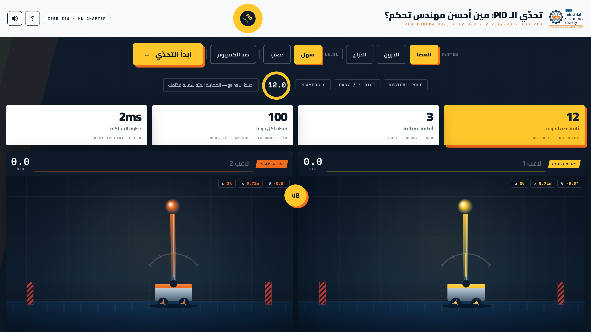

# PID Duel — IEEE IES · Hashemite University



لعبة البوث الرسمية: تحدّي ضبط PID للاعبَين على جهاز واحد، مع لوحة نتائج سحابية مشتركة عبر Firebase.
Booth game: two-player PID tuning duel with a shared cloud leaderboard (Firebase Firestore).

## التشغيل محليًا / Run locally
```bash
npm install
npm start            # http://localhost:3000
```
بدون متغيّر `FIREBASE_SERVICE_ACCOUNT_JSON` تشتغل اللعبة وضع **LOCAL** (لوحة كل جهاز) تلقائيًا.
Without the env var the game runs in LOCAL mode automatically.

## النشر على Render / Deploy
1. ارفع هذا الريبو على GitHub ثم Render ← New ← Web Service ← اختر الريبو.
   (يوجد `render.yaml` جاهز: runtime node، أمر البدء `node server.js`، فحص صحة `/api/health`.)
2. بالنظام: Environment ← أضف متغيّرًا باسم `FIREBASE_SERVICE_ACCOUNT_JSON` وقيمته محتوى ملف مفتاح الخدمة كاملًا (سطر واحد JSON).

## Firebase / إعداد السحابة
1. Console ← مشروع جديد ← فعّل **Firestore Database**.
2. Project settings ← Service accounts ← **Generate new private key** ← ملف JSON.
3. الصق محتواه بمتغيّر البيئة أعلاه (بالسيرفر المحلي: `.env` غير مستخدم عمدًا — مرّره عبر البيئة فقط).
4. قواعد Firestore المقترحة (الكتابة محصورة بالـ Admin SDK من السيرفر):
```
rules_version = '2';
service cloud.firestore {
  match /databases/{database}/documents {
    match /{document=**} { allow read, write: if false; }
  }
}
```
(الـ Admin SDK يتجاوز القواعد، فالعميل لا يلمس السحابة مباشرة أبدًا.)

## الـ API
- `GET /api/health` → `{ok, cloud}`
- `GET /api/leaderboard/:key` حيث key أحد `pole_e pole_h drone_e drone_h arm_e arm_h` → أعلى 50
- `POST /api/results` بجسم `{key, entries:[{n,s,g}]}` → حفظ دفعة نتائج جولة (محدد بمعدل طلبات)

اللعبة نفسها ملف واحد بـ `public/index.html` (خطوط مضمّنة، تعمل بدون إنترنت، وعند غياب السيرفر ترجع للوحة المحلية).
